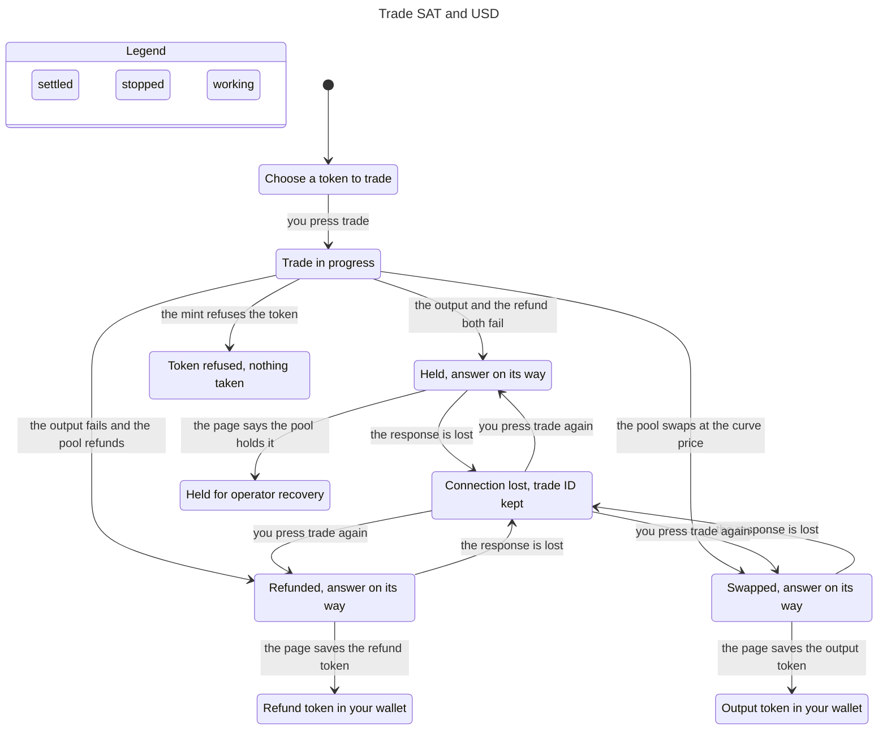
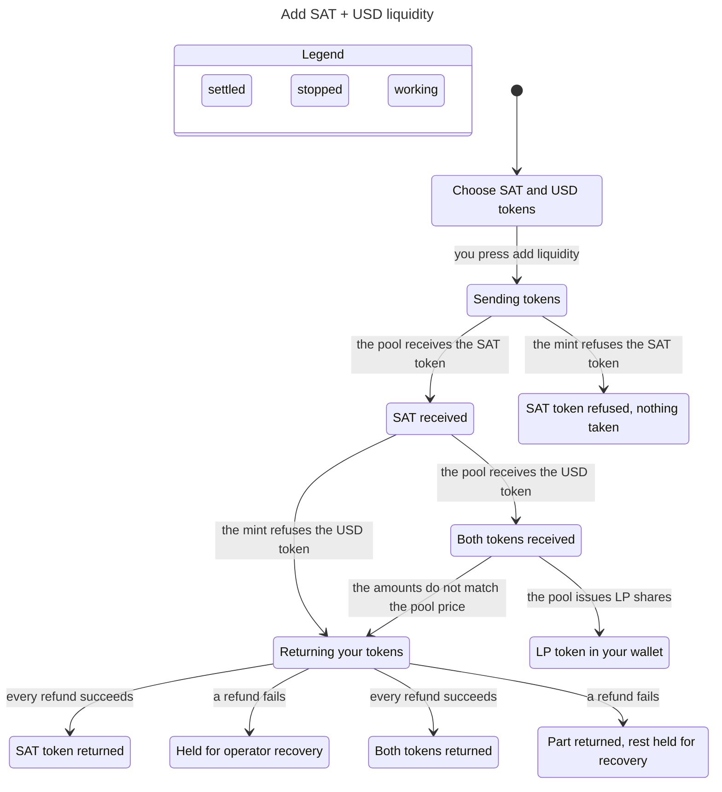

# Cashu AMM verification

Project-local skills under `.claude/skills` check the parts of the pool where a bug costs users money:

| Skill | What it checks | Tool | Scope |
| --- | --- | --- | --- |
| [verify-amm-custody](../../.claude/skills/verify-amm-custody/SKILL.md) | Every token the pool takes is in the pool, refunded, or on the recovery journal; a retried request gets the same tokens back | TLA+ / TLC | 58 states: one two-token deposit, any receive, issue, or refund failure, one lost response |
| [verify-amm-curve](../../.claude/skills/verify-amm-curve/SKILL.md) | Swaps never lower k; redemptions are pro rata; deposit or zap round trips never profit | Exhaustive run of `backend/amm.py` | 331,776 cases: every pool and amount up to 24 |

The custody model found two bugs, now fixed with regression tests:

1. **A partial refund closed the journal.** When a refused deposit returned the SAT token but failed to return the USD token, `_fail` completed the journal anyway. The pool then held USD that no record showed (commit 7c3e090).
2. **A lost refund response could not be replayed.** Only successful results were stored by `operation_id`, so a retry after a lost 409 tried to receive already-swapped proofs and lost the refund tokens (commit 88468ef).

## User flows

The charts were generated with pstack `/statechart` from the TLA+ models next to them. Regenerate one with `/statechart` on its `.tla` file and `view.mjs`, writing to a new folder.

### Trade SAT and USD

[TLA+ model](flows/trade/Trade.tla) · [TLC report](flows/trade/report.md)

### Add SAT + USD liquidity

[TLA+ model](flows/add-liquidity/AddLiquidity.tla) · [TLC report](flows/add-liquidity/report.md)

The charts hide terminal stuttering and the `Replay` step, which stays in the same chart state. They leave out the LP redemption flow, browser reloads, and operator recovery after a pending journal.
